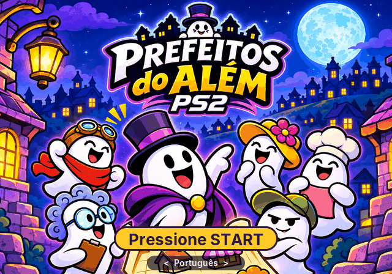
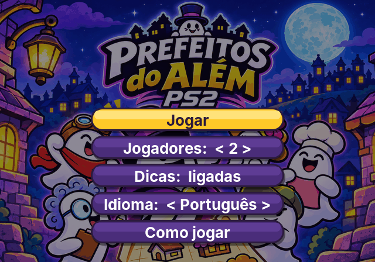
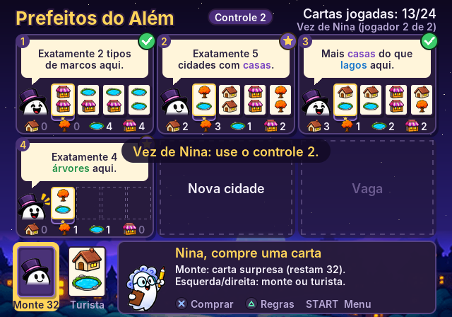
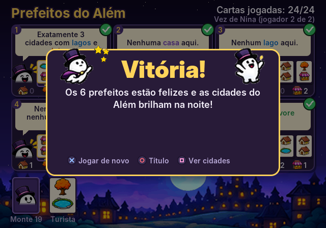
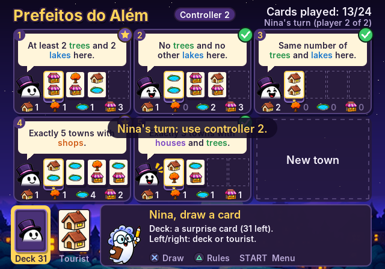
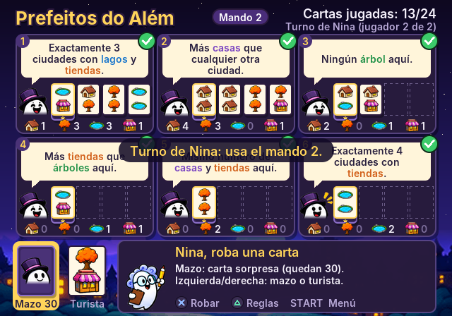

# Prefeitos do Além (PS2)

Jogo de cartas **cooperativo** para PlayStation 2 (homebrew), de 1 a 6 jogadores
com dois controles. Os fantasminhas do Além querem eleger prefeitos para 6 novas
cidades, e cada prefeito tem um pedido que precisa ser cumprido.



| Menu | Partida | Vitória |
|---|---|---|
|  |  |  |

## Música e efeitos sonoros

Todo o som é sintetizado em tempo real pelo próprio jogo (nenhum arquivo de
áudio), com instrumentos de "filme de fantasma":

- **Título:** valsa assombrada em lá menor com theremin, órgão e contrabaixo pizzicato.
- **Partida:** caixinha de música em ré menor com pad suave.
- **Vitória / derrota:** fanfarra com sinos / lamento de theremin.
- **Efeitos:** cursor, comprar e jogar carta, "uuuuu" de fantasma ao eleger um
  prefeito, brilho quando um pedido é cumprido, aviso grave quando o cursor está
  numa jogada perigosa (com dicas ligadas), pausa, páginas e erros.

Música e efeitos podem ser desligados no menu inicial. No PS2 o som sai pelo
`audsrv` (módulo embutido no ELF), numa thread própria. Para ouvir no PC:

```sh
make -f Makefile.host && mkdir -p build/audio && ./build/prefeitos_host --audio build/audio
```

## Idiomas

O jogo está em **português** (padrão), **inglês** e **espanhol**: menus, regras,
avisos e os pedidos das 50 cartas. Troque o idioma na tela de abertura
(direcional esquerda/direita) ou no menu, em **Idioma**.

| English | Español |
|---|---|
|  |  |

Cada jogador é um dos fantasminhas (Zaca, Nina, Lili, Beto, Dona Nena e o
Prefeito Fantasma). O prefeito de cada cidade muda de expressão: normal com o
pedido em aberto, feliz quando está cumprido, animado ao receber uma carta e
triste quando o pedido fica impossível.

## Regras

- **Objetivo:** jogando juntos, formem **6 cidades com 4 cartas cada** (24 cartas
  jogadas). A primeira carta de cada cidade vira o **prefeito**.
- **Preparação:** as 50 cartas são embaralhadas e 1 carta fica virada ao lado do
  monte: o **turista**.
- **No seu turno:**
  1. compre a carta do topo do **monte** ou o **turista**;
  2. jogue-a numa cidade com menos de 4 cartas, ou funde uma cidade nova
     (se houver menos de 6);
  3. se pegou o turista, um novo turista é virado do monte.
- **Prefeitos:** quando uma carta funda uma cidade, a carta do topo do monte vai
  virada para baixo embaixo dela (a estrela) e o pedido do prefeito fica **ativo**.
  Os pedidos das outras cartas não têm efeito.
- **Fim:** se algum pedido de prefeito não puder mais ser cumprido, vocês perdem na
  hora. Com 24 cartas jogadas e os 6 pedidos cumpridos, vocês **vencem**!

Cada carta tem 2 marcos: **casas**, **árvores**, **lagos** ou **lojas**. "Aqui"
conta todos os marcos da cidade (inclusive os do prefeito). "Outro" significa além
dos marcos da própria carta do prefeito. "Mais que qualquer outra cidade" não aceita
empate.

### Selos de cada prefeito

| Selo | Significado |
|---|---|
| Estrela | pedido em aberto |
| Verde | pedido cumprido no momento |
| Vermelho | pedido impossível (derrota) |

Com as **Dicas** ligadas (menu inicial), o jogo avisa antes de você confirmar uma
jogada que tornaria algum pedido impossível.

## Controles

**Dois controles:** o **controle 1** joga só os turnos do Jogador 1, e o
**controle 2** joga os turnos dos Jogadores 2 a 6 (passem o controle 2 entre
eles). Na partida, o controle que não é da vez não mexe nas cartas: o jogo avisa
"use o controle N", e o selo no topo da tela mostra qual controle joga agora
(fica vermelho se o controle 2 estiver desconectado). Menus, regras, pausa
(START) e a tela final aceitam os dois controles. Jogando sozinho, use o controle 1.

| Botão | Ação |
|---|---|
| START / ✕ na abertura | abrir o menu (esquerda/direita troca o idioma) |
| Direcional | escolher monte/turista e cidades |
| ✕ | confirmar (comprar / jogar a carta) |
| ○ | voltar |
| △ | regras |
| □ | na tela final, mostrar/esconder o resultado |
| START | pausa (continuar, regras, reiniciar, título) |

## Como rodar

Baixe a versão mais recente em **[Releases](https://github.com/thieffran88/Fantasminhas_PS2/releases)**.
O CI do GitHub também compila o jogo a cada push (aba **Actions**, artefato
`prefeitos-do-alem-ps2`), e ao enviar uma tag `v*` publica um release com:

- `prefeitos_do_alem.elf`: rode no **PCSX2** (*Sistema → Iniciar ELF*) ou num PS2
  real pelo **uLaunchELF/wLaunchELF** (pendrive USB).
- `prefeitos_do_alem.iso`: imagem de CD para PCSX2 ou **OPL**.

### Compilar localmente

Com o toolchain do [ps2dev](https://github.com/ps2dev/ps2dev) (via Docker):

```sh
docker run --rm -v "$PWD":/src -w /src ps2dev/ps2dev:latest \
  sh -c "apk add --no-cache build-base xorriso && make && make iso"
```

### Atualizar os sprites

Edite as folhas em `assets/source/` (ou os PNGs em `assets/sprites/`) e rode:

```sh
python3 tools/extract_sprites.py   # recorta as folhas (precisa de Pillow e numpy)
python3 tools/gen_sprites.py       # gera src/sprites_data.c e src/sprites_ids.h
```

### Versão de PC (testes)

As regras, a arte e a interface são C portável. Há uma build de PC sem janela,
usada para testar as regras e gerar as capturas de tela:

```sh
make -f Makefile.host test    # testes de regras + partidas automáticas
make -f Makefile.host shots   # gera screenshots/*.png (precisa de Python + Pillow)
```

## Estrutura

| Arquivo | Conteúdo |
|---|---|
| `src/game.c` | motor de regras, baralho de 50 cartas e textos dos pedidos (3 idiomas) |
| `src/ui.c` | telas (abertura, menu, regras, partida, pausa, fim) e controles |
| `src/audio.c` | sintetizador, músicas e efeitos sonoros |
| `src/lang.c` | textos da interface e das regras em português, inglês e espanhol |
| `src/art.c` | desenho de marcos, cartas, botões, selos e cenário |
| `src/sprites.c` | descompressão e desenho dos sprites |
| `assets/source/` | folhas de sprites originais |
| `assets/sprites/` | sprites recortados com fundo transparente |
| `tools/extract_sprites.py` | recorta as folhas em `assets/sprites/` |
| `tools/gen_sprites.py` | gera `src/sprites_data.c` (paleta + RLE, no tamanho de exibição) |
| `src/gfx.c` | renderizador por software (formas suavizadas e texto UTF-8) |
| `src/main_ps2.c` | PS2: vídeo via gsKit (quadro enviado como textura) e controle via libpad |
| `src/main_host.c` | PC: executa sequências de botões e salva capturas |
| `tools/gen_font.py` | gera `src/font_data.c` a partir da fonte Inter |
| `tests/test_rules.c` | testes das regras |

## Créditos

- Mecânicas adaptadas das regras de um jogo de cartas print-and-play. Textos,
  baralho e código são deste projeto.
- Sprites (personagens, expressões, marcos, efeitos e cenário) e arte da capa:
  imagens do projeto em `assets/source/`. A capa é recortada de forma a deixar de
  fora o selo de classificação etária e o logo de editora da arte original, já que
  o jogo não foi classificado nem é publicado por eles.
- Fonte [Inter](https://github.com/rsms/inter) (SIL Open Font License 1.1, veja
  `assets/OFL-Inter.txt`).
