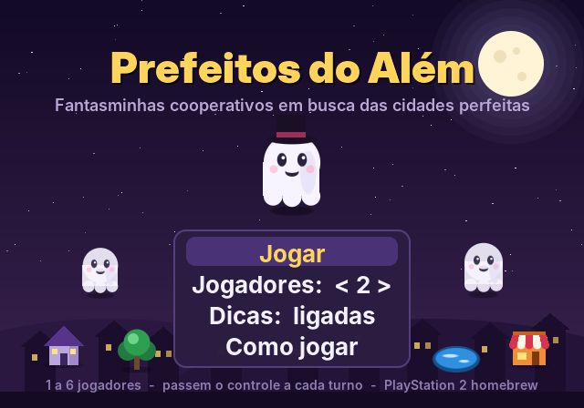
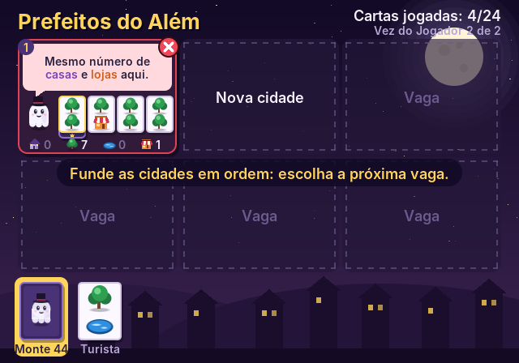
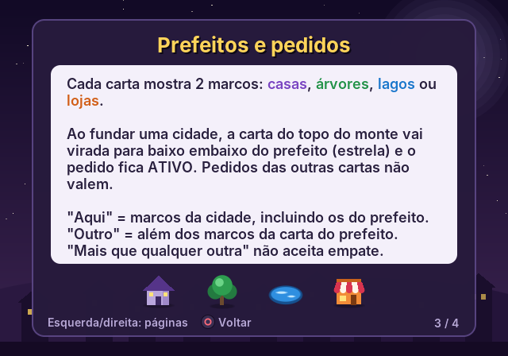
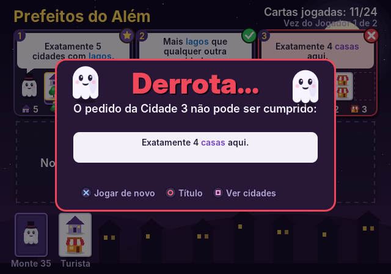

# Prefeitos do Além (PS2)

Jogo de cartas **cooperativo** para PlayStation 2 (homebrew), de 1 a 6 jogadores
passando o controle. Os fantasminhas do Além querem eleger prefeitos para 6 novas
cidades, e cada prefeito tem um pedido que precisa ser cumprido.



| Partida | Regras | Fim de jogo |
|---|---|---|
|  |  |  |

## Regras

- **Objetivo:** jogando juntos, formem **6 cidades com 4 cartas cada** (24 cartas
  jogadas). A primeira carta de cada cidade vira o **prefeito**.
- **Preparação:** as 50 cartas são embaralhadas e 1 carta fica virada ao lado do
  monte: o **turista**.
- **No seu turno:**
  1. compre a carta do topo do **monte** ou o **turista**;
  2. jogue-a numa cidade com menos de 4 cartas, ou funde uma cidade nova
     (se houver menos de 6);
  3. se pegou o turista, um novo turista é virado do monte.
- **Prefeitos:** quando uma carta funda uma cidade, a carta do topo do monte vai
  virada para baixo embaixo dela (a estrela) e o pedido do prefeito fica **ativo**.
  Os pedidos das outras cartas não têm efeito.
- **Fim:** se algum pedido de prefeito não puder mais ser cumprido, vocês perdem na
  hora. Com 24 cartas jogadas e os 6 pedidos cumpridos, vocês **vencem**!

Cada carta tem 2 marcos: **casas**, **árvores**, **lagos** ou **lojas**. "Aqui"
conta todos os marcos da cidade (inclusive os do prefeito). "Outro" significa além
dos marcos da própria carta do prefeito. "Mais que qualquer outra cidade" não aceita
empate.

### Selos de cada prefeito

| Selo | Significado |
|---|---|
| Estrela | pedido em aberto |
| Verde | pedido cumprido no momento |
| Vermelho | pedido impossível (derrota) |

Com as **Dicas** ligadas (menu inicial), o jogo avisa antes de você confirmar uma
jogada que tornaria algum pedido impossível.

## Controles

| Botão | Ação |
|---|---|
| Direcional | escolher monte/turista e cidades |
| ✕ | confirmar (comprar / jogar a carta) |
| ○ | voltar |
| △ | regras |
| □ | na tela final, mostrar/esconder o resultado |
| START | pausa (continuar, regras, reiniciar, título) |

## Como rodar

O CI do GitHub (aba **Actions**) compila o jogo a cada push e publica o artefato
`prefeitos-do-alem-ps2` com:

- `prefeitos_do_alem.elf`: rode no **PCSX2** (*Sistema → Iniciar ELF*) ou num PS2
  real pelo **uLaunchELF/wLaunchELF** (pendrive USB).
- `prefeitos_do_alem.iso`: imagem de CD para PCSX2 ou **OPL**.

### Compilar localmente

Com o toolchain do [ps2dev](https://github.com/ps2dev/ps2dev) (via Docker):

```sh
docker run --rm -v "$PWD":/src -w /src ps2dev/ps2dev:latest \
  sh -c "apk add --no-cache build-base xorriso && make && make iso"
```

### Versão de PC (testes)

As regras, a arte e a interface são C portável. Há uma build de PC sem janela,
usada para testar as regras e gerar as capturas de tela:

```sh
make -f Makefile.host test    # testes de regras + partidas automáticas
make -f Makefile.host shots   # gera screenshots/*.png (precisa de Python + Pillow)
```

## Estrutura

| Arquivo | Conteúdo |
|---|---|
| `src/game.c` | motor de regras, baralho de 50 cartas e textos dos pedidos |
| `src/ui.c` | telas (título, regras, partida, pausa, fim) e controles |
| `src/art.c` | arte procedural: fantasminhas, marcos, cartas, cenário |
| `src/gfx.c` | renderizador por software (formas suavizadas e texto UTF-8) |
| `src/main_ps2.c` | PS2: vídeo via gsKit (quadro enviado como textura) e controle via libpad |
| `src/main_host.c` | PC: executa sequências de botões e salva capturas |
| `tools/gen_font.py` | gera `src/font_data.c` a partir da fonte Inter |
| `tests/test_rules.c` | testes das regras |

## Créditos

- Mecânicas adaptadas das regras de um jogo de cartas print-and-play. Arte, textos,
  baralho e código são deste projeto.
- Fonte [Inter](https://github.com/rsms/inter) (SIL Open Font License 1.1, veja
  `assets/OFL-Inter.txt`).
